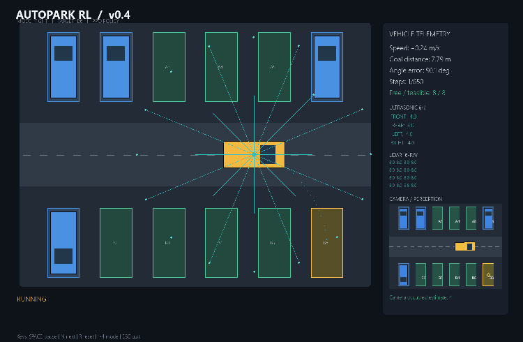
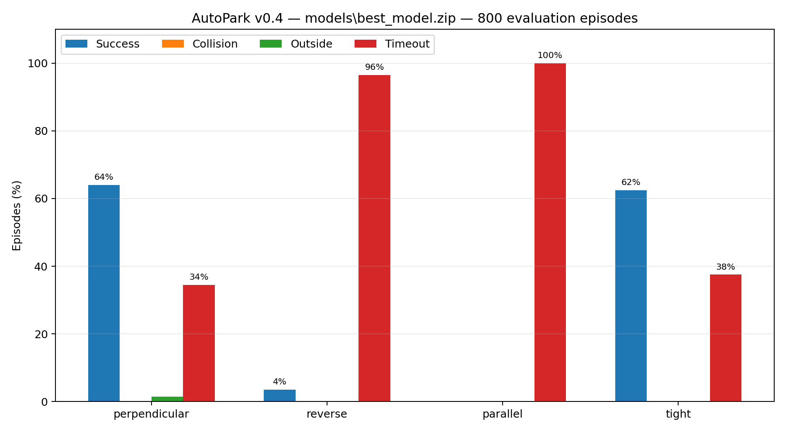
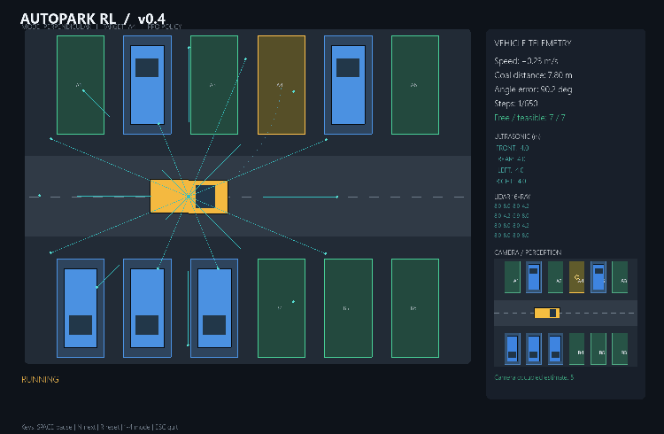
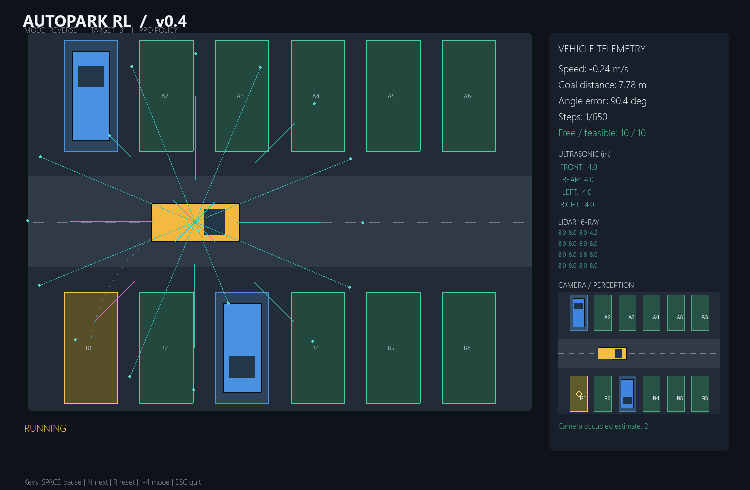
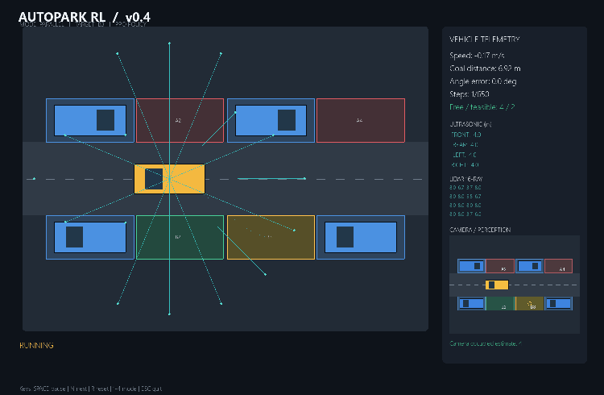
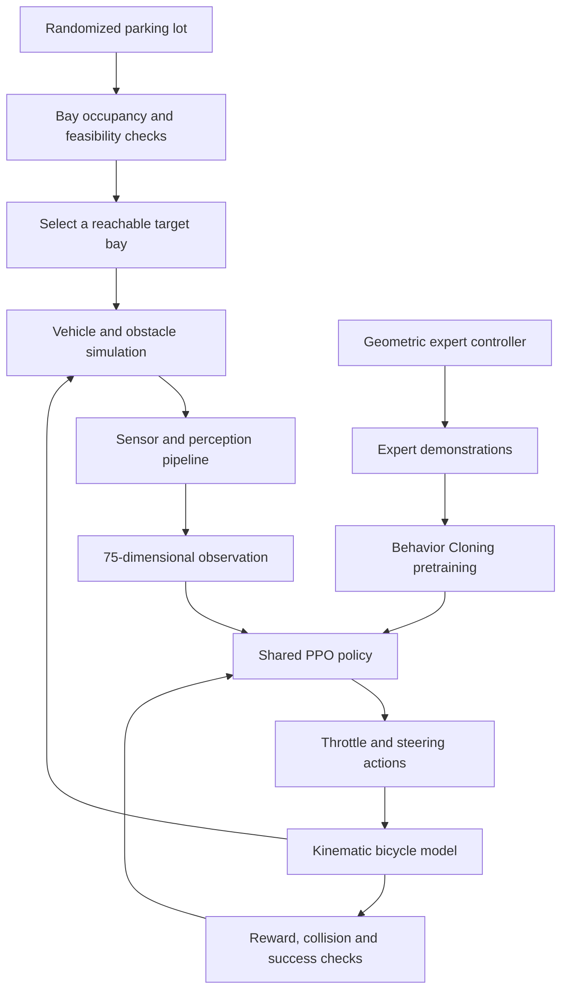

<div align="center">

# AutoPark RL

### Multi-Mode Autonomous Parking in a 2D Simulation

**Behavior Cloning · Proximal Policy Optimization · Sensor Fusion · Computer Vision**

[](https://www.python.org/)
[](https://gymnasium.farama.org/)
[](https://stable-baselines3.readthedocs.io/)
[](https://www.pygame.org/)
[](LICENSE)

**AutoPark RL** is an experimental autonomous-parking environment in which a vehicle-control policy learns to select a feasible parking bay, navigate around parked cars, and finish a parking manoeuvre using a kinematic vehicle model and simulated sensors.

<br/>



<sub>Example rollout from the current v0.4 checkpoint. See the per-mode evaluation below for the full, unfiltered results.</sub>

</div>

---

## Overview

The project began as a small reinforcement-learning experiment: teach a simulated car to park in a marked bay. It has since grown into a multi-mode benchmark with randomized parking lots, obstacle-aware bay selection, a synthetic camera, range sensors, expert demonstrations, and PPO fine-tuning.

Version **0.4** evaluates one shared PPO policy across four manoeuvre types:

| Mode | Task |
|---|---|
| `perpendicular` | Forward entry into a perpendicular parking bay |
| `reverse` | Reverse entry into a perpendicular bay |
| `parallel` | Curved reverse manoeuvre into a parallel parking space |
| `tight` | Entry into a narrower bay with denser nearby obstacles |

At the beginning of each episode, the environment generates a parking layout, checks candidate bays for occupancy and geometric feasibility, and selects a reachable target. The agent then receives a 75-dimensional observation and outputs continuous vehicle controls.

> **Current status:** the v0.4 environment, expert controller, sensor pipeline, and evaluation tooling are implemented. The current learned policy is a work in progress: it performs reasonably in perpendicular and tight parking, but reverse and parallel parking remain unsolved. The benchmark below reports the actual evaluation results rather than presenting the project as a finished self-driving system.

## Current results — v0.4

**Evaluation date:** 9 November 2026  
**Policy:** `models/best_model.zip`  
**Evaluation set:** 800 episodes total — 200 per mode  
**Difficulty:** 0.62

### Success rate by mode

| Parking mode | Episodes | Success | Collision | Outside bounds | Timeout |
|---|---:|---:|---:|---:|---:|
| Perpendicular | 200 | **64.0%** | 0.0% | 1.5% | 34.5% |
| Reverse | 200 | **3.5%** | 0.0% | 0.0% | 96.5% |
| Parallel | 200 | **0.0%** | 0.0% | 0.0% | 100.0% |
| Tight | 200 | **62.5%** | 0.0% | 0.0% | 37.5% |
| **Overall** | **800** | **32.5%** | **0.0%** | **0.375%** | **67.125%** |



### Additional aggregate metrics

| Metric | Result |
|---|---:|
| Mean episode length | 483.87 steps |
| Mean final position error | 0.718 m |
| Mean final heading error | 10.41° |
| Mean reward | 71.65 |
| Camera occupancy match rate | 100% in the reported simulation evaluation |

The zero-collision result is encouraging, but it should be interpreted together with the **67.125% timeout rate**. In particular, the current policy does not yet complete reverse and parallel manoeuvres reliably.

### Recorded policy rollouts

The following GIFs were generated from the evaluated v0.4 policy. The recorded seed produced a timeout in three modes and a successful tight-parking episode; the GIFs are included as diagnostic evidence, not as a claim that every mode is solved.

| Mode | Recorded outcome | Rollout |
|---|---|---|
| Perpendicular | Timeout |  |
| Reverse | Timeout |  |
| Parallel | Timeout |  |
| Tight | **Success — 131 steps** |  |

### Historical single-task baseline — v0.3

Before introducing four different manoeuvres, v0.3 reached **93% success on a 200-episode evaluation** of the earlier, single-task multi-bay parking setup. That result is retained as a historical baseline, but it is **not directly comparable** with v0.4: v0.4 combines four distinct parking tasks and evaluates each one separately.

---

## System architecture



### Learning pipeline

Training follows a **Behavior Cloning → PPO** workflow:

1. **Expert demonstrations.** A geometric path-following controller generates trajectories for the four parking modes.
2. **Behavior Cloning (BC).** A neural policy is pretrained to imitate the expert's continuous control actions.
3. **PPO fine-tuning.** The BC-initialized policy continues learning through interaction with randomized environments. PPO is the only reinforcement-learning algorithm used in this project; SAC is not included.
4. **Curriculum learning.** Parking-lot occupancy is gradually increased during training, from easier layouts to denser scenarios.
5. **Success-aware model selection.** Evaluation checkpoints are ranked by aggregate success first, then weakest-mode success, safety outcomes, and reward.

### Vehicle model and action space

The simulator uses a **kinematic bicycle model**. The policy emits a two-dimensional continuous action:

- longitudinal control (acceleration / braking, including signed reverse motion);
- steering control.

Both action values are normalized to `[-1, 1]`. The model is intended for controlled simulation experiments; it does not reproduce full tire dynamics, suspension, drivetrain, or real-world traction limits.

## Perception and sensor suite

The current observation contains **75 values** assembled from vehicle state, task context, range sensors, bay state, and camera-derived occupancy.

| Component | Configuration | Purpose |
|---|---|---|
| LiDAR | 16 rays, up to 8 m | Detect nearby obstacles around the vehicle |
| Ultrasonic sensors | 4 directions, up to 4 m | Short-range front, rear, left, and right distance estimates |
| Virtual camera | 288 × 216 RGB, top-down | Render the parking lot and estimate bay occupancy |
| Bay state | 12 occupancy values + 12 feasibility values | Represent candidate parking-space status |
| Camera perception | 12 occupancy estimates | Add image-derived occupied-bay information to the observation |
| Vehicle and task state | Pose, speed, relative target pose, path progress, mode, gear | Describe the current manoeuvre and control state |

The virtual camera currently uses **synthetic imagery and semantic colour segmentation** to estimate whether parking bays are occupied. The reported 100% camera occupancy match is a simulator consistency check against the generated map; it is **not** a real-world object-detection benchmark and does not mean that a learned vision model has been trained on natural images.

## Parking-space selection

The environment generates up to 12 candidate spaces per episode. A candidate is considered only if:

- the bay is not occupied;
- the vehicle fits inside the marked dimensions with a clearance margin;
- the vehicle body does not intersect parked cars along the approach path;
- the sampled approach trajectory remains inside the lot boundaries.

Feasible candidates are scored using approach distance and nearby-vehicle penalties. The environment then samples a target from the feasible set. This makes target selection part of the task rather than fixing one parking coordinate for every episode.

## Repository structure

```text
AutoPark-RL/
├── configs/
│   └── default.yaml
├── models/                         # generated locally; model weights are not committed
│   └── checkpoints/
├── reports/
│   ├── evaluation/                 # CSV/JSON metrics and generated REPORT.md
│   ├── figures/                    # evaluation chart and demonstration GIFs
│   ├── tensorboard/                # TensorBoard logs
│   └── training/                   # BC metrics, expert demos and PPO evaluation history
├── scripts/
│   ├── train.py                    # expert demonstrations -> BC -> PPO
│   ├── evaluate.py                 # per-mode and aggregate evaluation
│   ├── visualize.py                # interactive Pygame viewer
│   ├── record_demo.py              # record one GIF per mode
│   └── make_report.py              # build a Markdown report from evaluation JSON
├── src/autopark/
│   ├── environment/
│   │   └── parking_env.py          # Gymnasium multi-mode environment
│   ├── physics.py                  # vehicle state and bicycle model
│   ├── sensors.py                  # LiDAR and ultrasonic simulation
│   ├── vision.py                   # virtual camera and occupancy segmentation
│   ├── imitation.py                # expert data and Behavior Cloning
│   └── simulation/
│       └── renderer.py             # Pygame rendering and sensor overlays
├── tests/
├── requirements.txt
├── LICENSE
└── README.md
```

## Installation

The project is designed to run locally on Windows, including from the PyCharm terminal. Python **3.10 or 3.11 (64-bit)** is recommended.

```powershell
py -3.11 -m venv .venv
.\.venv\Scripts\Activate.ps1
python -m pip install --upgrade pip
pip install -r requirements.txt
```

If Python 3.10 is the interpreter already configured in PyCharm, create the environment with `py -3.10` instead of `py -3.11`.

## Run the project

Run commands from the repository root.

### 1. Verify the environment and expert controller

```powershell
python scripts/evaluate.py --expert --episodes 100
```

With `--mode all`, this evaluates 100 episodes for **each** mode (400 episodes total). The expert controller is a geometric reference policy; it is not the learned PPO model.

To isolate one mode:

```powershell
python scripts/evaluate.py --expert --mode parallel --episodes 200
```

### 2. Train Behavior Cloning + PPO

```powershell
python scripts/train.py --timesteps 3000000
```

Default training configuration:

| Parameter | Default |
|---|---:|
| Expert demonstration episodes | 1,200 total, balanced across modes |
| Behavior Cloning epochs | 30 |
| PPO environment steps | 3,000,000 |
| Evaluation frequency | Every 50,000 steps |
| Evaluation episodes | 12 per mode at each checkpoint |
| Checkpoint frequency | Every 250,000 steps |
| Curriculum difficulty | 0.08 → 0.62 |
| Device | CPU by default |

For a CUDA-enabled PyTorch installation:

```powershell
python scripts/train.py --timesteps 3000000 --device cuda
```

Resume a previous v0.4 PPO run:

```powershell
python scripts/train.py --timesteps 1000000 --resume
```

The selected policy is written to `models/best_model.zip`; the latest policy is written to `models/final_model.zip`. Periodic checkpoints are stored in `models/checkpoints/`.

### 3. Evaluate the learned policy

```powershell
python scripts/evaluate.py --episodes 200
```

The default `--mode all` runs 200 episodes **per mode** (800 total). The evaluation produces:

- `reports/evaluation/episodes.csv` — episode-level results;
- `reports/evaluation/summary_by_mode.json` — aggregate and per-mode metrics;
- `reports/figures/evaluation_v04.png` — comparison chart.

Evaluate a single mode:

```powershell
python scripts/evaluate.py --mode tight --episodes 500
```

Run a denser-lot stress test:

```powershell
python scripts/evaluate.py --mode all --episodes 300 --difficulty 0.75
```

### 4. Open the interactive simulation

```powershell
python scripts/visualize.py
```

Useful variants:

```powershell
python scripts/visualize.py --mode parallel
python scripts/visualize.py --mode tight --difficulty 0.65
python scripts/visualize.py --expert --mode reverse
```

Keyboard controls:

| Key | Action |
|---|---|
| `SPACE` | Pause / resume |
| `N` | Load the next scenario |
| `R` | Reset the current scenario |
| `1` | Perpendicular mode |
| `2` | Reverse mode |
| `3` | Parallel mode |
| `4` | Tight mode |
| `ESC` | Quit |

### 5. Record GIF demonstrations

```powershell
python scripts/record_demo.py --mode all
```

The four GIFs are saved to `reports/figures/`. To record the expert reference controller instead of the learned policy:

```powershell
python scripts/record_demo.py --mode all --expert
```

### 6. Generate the Markdown evaluation report

```powershell
python scripts/make_report.py
```

This creates `reports/evaluation/REPORT.md` from the latest `summary_by_mode.json`.

### 7. Run tests

```powershell
python -m pytest -q
```

The tests cover observation shape and values, mode/task generation, expert completion, sensor dimensions, camera occupancy consistency, and mutually exclusive terminal outcomes.

## Outputs and experiment tracking

| Path | Contents |
|---|---|
| `models/best_model.zip` | Best checkpoint according to success-aware evaluation |
| `models/final_model.zip` | Latest PPO policy at the end of training |
| `models/checkpoints/` | Periodic PPO checkpoints |
| `models/model_metadata.json` | Model configuration and training metadata |
| `reports/training/expert_demonstrations.json` | Expert demonstration statistics |
| `reports/training/behavior_cloning.json` | BC training metrics |
| `reports/training/bc_baseline_by_mode.json` | BC-initialized policy evaluation before PPO |
| `reports/training/success_evaluations.jsonl` | Per-checkpoint PPO evaluation history |
| `reports/evaluation/summary_by_mode.json` | Final aggregate and per-mode evaluation |
| `reports/figures/` | Charts and recorded GIFs |

Model weights, large demonstration datasets, and TensorBoard event logs are generated locally and are intentionally excluded from the source repository by `.gitignore`.

> **GitHub media note:** the repository's `.gitignore` may ignore `reports/figures/*.png` and `reports/figures/*.gif`. If the images are not already tracked, add the portfolio assets explicitly:
>
> ```powershell
> git add -f reports/figures/evaluation_v04.png reports/figures/autopark_*.gif
> ```

## Design decisions and limitations

- **One shared policy in v0.4.** The four modes are encoded in the observation and trained through one PPO policy. The current results show that this multi-task setup has not learned all manoeuvres equally well.
- **Synthetic perception.** The top-down camera and colour-segmentation pipeline are generated inside the simulator. There is no trained detector for real camera images yet.
- **Kinematic physics.** The bicycle model is useful for steering experiments but omits tire slip, friction variation, suspension, actuator delay, and detailed vehicle dynamics.
- **Static obstacles.** Parked vehicles are static during an episode; moving traffic and pedestrians are not simulated.
- **Simulation-only validation.** Success rates measure performance on generated in-domain scenarios. They do not establish readiness for a physical vehicle.

## Roadmap

The next research iteration is focused on diagnosing and improving the weak manoeuvres rather than simply increasing the training budget:

- compare a shared policy with mode-specialized PPO agents;
- improve reverse and parallel path tracking with explicit look-ahead/path-relative observations;
- test sensor noise, dropouts, partial camera occlusion, and randomized vehicle dimensions;
- measure generalization across held-out parking layouts and difficulty levels;
- add a learned visual-perception front end and compare it with the current semantic segmentation baseline;
- report confidence intervals and per-mode results over multiple random seeds.

## Version history

| Version | Summary |
|---|---|
| `v0.1` | Single-target 2D parking environment and initial PPO experiment |
| `v0.2` | Multi-bay lot generation, free-space checks, and randomized target selection |
| `v0.3` | Behavior Cloning initialization followed by PPO; 93% success on the earlier single-task evaluation (200 episodes) |
| `v0.4` | Four parking modes, 75-value sensor-fusion observation, virtual camera, BC + PPO, and per-mode benchmark |

## License

This project is distributed under the [MIT License](LICENSE).

---

<div align="center">

**AutoPark RL — learning to park, one manoeuvre at a time.**

</div>
